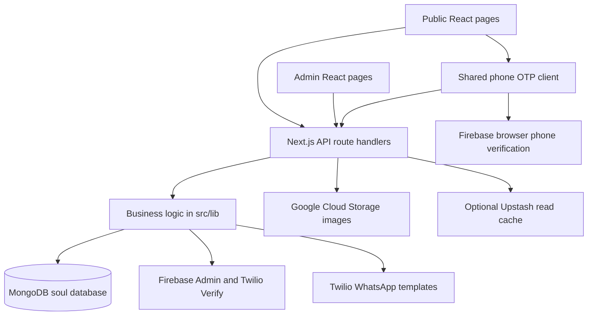

# SoulClinic project overview

Source audit for future feature work, reviewed on **2026-10-23** against local `main` at `ea36a31d8e24854b717e8d7fc931bbab05db1b59`.

This is a map of the application as implemented: public pages, admin tools, appointments, customers, treatment and perfume catalogs, backend routes, storage, messaging, and supporting code. It distinguishes intended UI behavior from what the server actually enforces. The audit is based on local source and existing documentation; it does not establish the state of the deployed site, database contents, provider configuration, or live delivery. No application code, configuration, dependencies, environment files, or cloud data were changed. Only this document was created.

Quick navigation: [owner rule](#1-owner-rule-for-all-future-updates), [booking](#7-creating-an-appointment), [cancel/move/block/edit](#9-admin-cancellation-moving-appointments-and-editing-availability), [dashboard](#10-the-operational-dashboard-and-its-controls), [users](#11-users-page-explained), [services](#12-treatment-and-perfume-management), [findings](#17-findings-to-keep-visible-before-adding-features), [future feature map](#18-where-to-work-when-a-feature-is-requested).

**Subsequent implementation:** the owner's later feature request was implemented on `codex/customer-treatment-plans-feedback` and merged into `main` by the owner. Customer profiles, all available appointments, separate booking notes/feedback, current saved-program details/statuses, transactional treatment-plan booking and consolidated WhatsApp notifications are explained in [TREATMENT_PLANS_AND_FEEDBACK.md](TREATMENT_PLANS_AND_FEEDBACK.md), including the Arabic templates and configuration. The profile follow-ups (contact links, pagination, collapsible sections, private admin comments and permanent deletion of fully canceled programs) remain local on `main` for the owner's review. Read that document for those additions instead of duplicating them here. The original audit below describes the baseline commit above; its statement that only documentation changed applies to the audit phase.

**Monthly return reminders:** eligibility, booking pauses, attendance resets, shared permission, both unsubscribe methods, durable send claims, cron integration and manual setup are explained in [RETURN_REMINDERS.md](RETURN_REMINDERS.md). Read that file for the new behavior; it is not duplicated in this baseline audit.

**Monthly schedule planner:** the weekday-group editor, its preview/apply workflow, booking preservation and retry handling are explained in [MONTHLY_SCHEDULE_PLANNER.md](MONTHLY_SCHEDULE_PLANNER.md). That document also records removal of the obsolete monthly blocker; read it for current monthly scheduling behavior.

## 1. Owner rule for all future updates

**Keep this project's existing languages, stack, conventions, and behavior unless the owner explicitly requests a change.**

- Application code stays **JavaScript and JSX**, using the existing `.js` and `.jsx` files. Preserve `.mjs` and `.cjs` where already used for configuration and test tooling. Do not migrate the project to TypeScript or another language.
- Keep the existing Next.js App Router, React, Tailwind/CSS, MongoDB driver, authentication, storage, and messaging approach. Do not replace frameworks, databases, providers, styling systems, or package managers as an incidental part of a feature.
- Preserve Arabic UI text, right-to-left layouts, existing identifiers, route spellings, collection names, environment-variable names, and phone conventions. Names such as `bookforCustumer`, `cancelaptByuser`, `AttendetAppointmentsList`, and `FIREBASE_STORAGE_BUCKET` are existing contracts, even where their spelling is unusual.
- Reuse the current helpers and UI components. A feature request does not automatically authorize unrelated refactoring, dependency upgrades, changing booking rules, altering OTP policy, or changing deployment settings.
- Keep changes limited to the requested feature. Explain a necessary compatibility change before including it; do not silently broaden scope.
- Read this overview and the relevant linked documents before implementing. Update the appropriate existing document when behavior changes rather than copying its explanation into multiple files.

## 2. Existing documentation to read instead of duplicating

The documents below already explain OTP internals, migration history, recovery, and browser verification. Their detailed explanations are intentionally not repeated here.

| Document | What is already explained there | How to use it |
| --- | --- | --- |
| [FIREBASE_FIRST_OTP_IMPLEMENTATION.md](FIREBASE_FIRST_OTP_IMPLEMENTATION.md) | Firebase/Twilio architecture, provider state machine, original fallback matrix, limits, readiness, Admin SDK compatibility, rollout and rollback records. | Main implementation background. Later diagnostics follow-ups supersede parts of its original fallback matrix. Historical deployment statements are records, not fresh deployment checks. |
| [OTP_FAILURE_DIAGNOSTICS.md](OTP_FAILURE_DIAGNOSTICS.md) | Sending/recovery UI, safe diagnostics, SDK error identifiers, code-39 exception, progressive booking UI, success redirect, technical recovery, alternative-provider action, and scrolling. | Read especially **Technical Recovery and Slower Scrolling (2026-09-17)** for the latest documented recovery policy in this checkout. Earlier sections describe earlier stages. |
| [TWILIO_OTP_MIGRATION.md](TWILIO_OTP_MIGRATION.md) | Twilio send/verification recovery, grants, rate controls, native Google Cloud Storage migration, preserved storage variable names, and operational setup. | Historical migration context. Its claim that every environment is Twilio-only is superseded by the later Firebase-first implementation. |
| [FIREBASE_FIRST_OTP_PLAN.md](FIREBASE_FIRST_OTP_PLAN.md) | Implementation tasks, constraints, and execution record for Firebase-first OTP V2. | Historical plan; the current source and later follow-ups determine current behavior. |
| [Customer session design](docs/superpowers/specs/2026-08-23-firebase-first-otp-customer-session-design.md) | Original phone identity, customer cookie, appointment authorization, bounded state, and booking completion design. | Local historical design, including the **Customer Session** and **Appointment Authorization** sections. Collection names and recovery implementation have evolved. |
| [Customer session implementation plan](docs/superpowers/plans/2026-08-23-firebase-first-otp-customer-session.md) | Original step-by-step implementation and regression-test plan. | Local historical plan, not a replacement for inspecting current code. |
| [Browser harness README](tests/e2e/firebaseOtpV2/README.md) | Browser-test launch commands, runtime discovery, harness boundaries, mocks, coverage, and artifacts. | Authoritative description of what the browser tests do and do not verify. |
| [Browser contracts](tests/e2e/firebaseOtpV2/CONTRACTS.md) and [recorded results](tests/e2e/firebaseOtpV2/RESULTS.md) | Frontend integration contracts and historical test evidence. | Coordination/history, not a test result from this audit. |
| [README.md](README.md) | Only the text `CLinc`. | It currently contains no useful architecture or setup guide. |

`docs/` is ignored and its two documents above are present locally but not tracked in this checkout. `tests/` is also ignored, although many test sources are already tracked. A fresh checkout may therefore lack local design documents; preserve the existing ignore rules and check tracking deliberately when adding future documentation or tests.

## 3. Architecture and technology

This is one Next.js application containing both frontend pages and backend HTTP handlers. There is no separate Express service, ORM, Firestore application database, or standalone worker in the inspected source.

| Layer | Existing implementation |
| --- | --- |
| Framework | Next.js **16.1.4**, App Router under `src/app`; React/React DOM **19.2.3**. Versions here describe `package.json`, not a recommendation to upgrade. |
| Language/module style | JavaScript/JSX, ES imports in application source; `.mjs` and CommonJS `.cjs`/selected `.js` configs. `jsconfig.json` maps `@/*` to `src/*`. |
| UI | Tailwind **3.4.x** through PostCSS and Autoprefixer; global CSS variables; Framer Motion, Lucide, React Icons, Sonner; small Radix/CVA-based primitives. |
| UI state/network | Component state/effects, Axios and some `fetch`; no central Redux-style store or query-cache layer. |
| Data | Native `mongodb` **7.x** driver, database name hardcoded as `soul`. Embedded arrays and MongoDB aggregation/update pipelines. |
| Authentication | Admin bcrypt/JWT; customer phone OTP and separate application session. See linked OTP/session documentation for customer internals. |
| Media/cache/messaging | Native `@google-cloud/storage`; optional `@upstash/redis`; Twilio Verify for SMS and Twilio Messaging for WhatsApp. Firebase browser/Admin SDKs support phone verification. |
| Specialized UI | `date-fns` calendars, Recharts statistics, `@dnd-kit` reordering, Three.js/React Three Fiber/Drei for retained perfume visuals. |
| Verification | ESLint 9 with Next core web vitals; Vitest 4 in Node; isolated MongoDB tests; separate Playwright browser harness. |

Repository navigation:

| Location | Responsibility |
| --- | --- |
| `src/app/**/page.js` | Public/admin routes; most business screens are client components. |
| `src/app/api/**/route.js` | Backend API methods, validation, access checks where implemented, database writes, integrations. |
| `src/components/admin/` | Calendar, manual booking, customer table/modal, statistics, image upload, profile/password widgets. |
| `src/components/ui/` | Booking calendar/time/form, login forms, reusable controls and presentation helpers. |
| `src/lib/` | Shared scheduling, booking, cancellation, auth, database, storage, phone and messaging functions. |
| `src/lib/otp/` and `src/hooks/usePhoneOtp.js` | Existing documented phone verification subsystem. |
| `src/lib/cache/redisReadCache.js` | Optional public hero/catalog cache; not an appointment or customer cache. |
| `src/proxy.js` | Admin-page/login redirects. API authorization must be implemented separately. |
| `public/` | Logos and retained perfume GLB model. |
| `tests/` | OTP, booking, security, storage and browser-harness tests. |

`package.json` also includes packages/configuration that should not be assumed active merely because installed. For example, image uploads use `req.formData()`, not a Multer middleware, and the configured PostCSS pipeline uses Tailwind 3 rather than the separately installed `@tailwindcss/postcss` package.

## 4. Page and navigation map

| URL | Meaning and source |
| --- | --- |
| `/` | Homepage: hero image fetched from `/api/admin/upload-hero-image`, clinic navigation and external perfume-site link. `src/app/page.js`. |
| `/dashboard` | **Public treatment catalog**, not the administrative dashboard. Loads `/api/admin/treatments`, renders treatment cards and links to details. `src/app/dashboard/page.js`. |
| `/treatments/[id]` | Treatment details and its embedded services; selected service becomes booking query parameters. `src/app/treatments/[id]/page.js`. |
| `/appointments` | Booking route wrapper plus `AppointmentsClient.js`; calendar, available times and verified customer form. |
| `/login` | Choice between admin credentials (`LoginBox`) and customer phone verification (`LoginPage`). |
| `/userAppointments` | Customer's own appointment table and cancellation/logout controls; wrapper plus `UserAppointmentsClient.js`. |
| `/about` | Static clinic/about content. |
| `/contact` | Static contact details, WhatsApp/Instagram links and embedded map; no contact-submission backend. |
| `/admin` | Admin navigation hub. |
| `/admin/profile` | Operational admin dashboard: daily calendar, manual booking, monthly schedule planning, income/cups statistics, hero upload and password controls. |
| `/admin/users` | Customer list, attendance overview, appointment history/actions and notes. |
| `/admin/treatments` | Treatment category and service management. |
| `/admin/perfumes` | Retained perfume category/product management. |
| `/perfumes`, `/perfumes/[category]` | **No active page routes from these files**: page/layout filenames are `*.disabled.js`. The APIs and admin screen still exist. The external perfume site is a separate destination. |

The global shell is `src/app/layout.js`: metadata, Arabic document direction, header, footer and floating contact buttons. `Header/page.js` checks `/api/me` to decide whether to show the admin link. That check is presentation logic, not authorization. `admin/layout.js` is a layout wrapper; `src/proxy.js` protects navigation to `/admin/**` and redirects an already authenticated admin away from `/login`.

## 5. Core data model and business vocabulary

`src/lib/db.js` owns the MongoClient, cached database connection, `getCollection(name)`, and `getMongoClient()`. The URI comes from `MONGO_URI`; the database is always named `soul` in this code. There are no schema/model classes or migration runner enforcing all document shapes.

### Appointment data is stored twice

**One appointment has a shared embedded MongoDB ObjectId in two different documents.** These are not two independent bookings.

| Collection/document | Fields and purpose |
| --- | --- |
| `appointments`, one document per `date` | `date` (`YYYY-MM-DD`), `appointments[]`, `blockedTimes[]`, `editedTimes[]`. This is the availability and calendar view of a day. |
| `appointments.appointments[]` | `_id`, `firstName`, `lastName`, normalized `phone`, `time` (`HH:mm`), numeric `duration`, `reminderSent`, optional `cupsCount`. It does not store the service title or price when created. |
| `usersData`, found by normalized phone | `_id`, `phone`, `firstName`, `lastName`, `createdAt`, `appointments[]`, `notes[]`, optional `adminNotes[]`. This is the customer's profile/history. |
| `usersData.appointments[]` | Same appointment `_id`, `date`, `time`, `title`, numeric `price`, `attended: false` initially, optional `cupsCount`. It does not store duration when created. |
| `usersData.notes[]` | Booking-provided `{text, date, time}`. These are associated by date/time, not by a dedicated note/appointment ID. |
| `usersData.adminNotes[]` | Staff notes with UUID `id`, `text`, `createdAt`, `updatedAt`; separate from booking notes. |

Consequences for future work:

- Availability/calendar use the day document; attendance, income, cups and customer history use `usersData`.
- Moving, removing, or creating an appointment must consider both representations. A new field must be placed in the representation read by its consumers.
- Admin calendar titles are joined from customer history by **phone + date + time**, even though a shared appointment ID also exists.
- A cancelled appointment is normally **removed**, not retained with a `cancelled` status. Do not assume there is a cancellation history or a general booking-status enum.
- `attended` is a boolean maintained only on customer appointment entries. “Missed,” “upcoming,” and “completed” in several screens are derived date comparisons, not stored workflow states.
- `blockedTimes` disables starting at specific strings. `editedTimes` replaces the day's offered start-time list when nonempty. An empty `editedTimes` restores the default schedule; it does not mean the clinic is closed.
- Current customer identity is the normalized Israeli mobile phone, not a Firebase UID or an admin account. Phone-normalization behavior lives in `src/lib/phone.js`.

### Other collections

| Collection | Purpose |
| --- | --- |
| `adminLogin` | Admin `_id`, username, bcrypt password hash and role; credentials login and password changes. No admin-registration UI is present. |
| `treatments` | Treatment categories with embedded `services[]`; details below. |
| `perfumeCategories` | Perfume categories with embedded `perfumes[]`; retained admin/public APIs. |
| `settings` | Hero-image record and per-year manual income adjustment records. |
| `otpChallengesV2`, `otpSecurityState`, `otpSourceSecurityState`, `otpVerificationGrants` | Existing documented OTP challenge, limit and grant storage. Read the linked OTP documents and `src/lib/otp/` for their current schema. |
| `appointmentCancellationClaims` | Short-lived ownership/phase records for customer cancellation without transactions. |
| `appointmentCancellationReceipts` | Short-lived transactional cancellation outcome/notification evidence. |

`appointmentConcurrency.ensureAppointmentsDateIndex()` attempts a unique `date` index (`unique_appointment_date`). Some block/edit handlers upsert partial day documents, so readers commonly default missing arrays to `[]`. A globally unique customer-phone index is not created by the inspected application helpers. Cancellation and OTP helpers lazily create their own indexes; exact cancellation recovery is described below and OTP index details remain in the existing docs.

## 6. Scheduling rules and time handling

Main source: `src/lib/appointmentRules.js`; atomic database availability implementation: `src/lib/appointmentConcurrency.js`. These implementations have edge-case differences noted in section 17. The public time picker and admin components also contain local copies of scheduling calculations, so changing only one file will not update every consumer.

| Rule | Actual behavior |
| --- | --- |
| Default start list | Half-hour starts from `10:00` through `19:30`. |
| Closing limit | Appointment end must be at or before `19:30`. Thus a normal 30-minute appointment's latest usable start is `19:00`, even though `19:30` appears in the base list. |
| Duration | Positive finite numeric conversion; otherwise defaults to 30 minutes. Not restricted to half-hour multiples. |
| Custom schedule | A nonempty `editedTimes` array replaces defaults for that date. The normal JS rules filter to working hours and sort. |
| Existing appointment overlap | Intervals overlap when `startA < endB && endA > startB`; adjacent end/start boundaries are allowed. Duration, not only start equality, matters. |
| Blocking | Exact proposed start must not appear in `blockedTimes`. Blocks are not duration-bearing intervals. A longer appointment can span a later blocked start if its own start is unblocked. |
| Weekends and horizon | No recurring weekday closure or maximum advance-booking horizon is encoded in the shared rules. Availability is day-specific. |
| Past dates/times | Public calendar disallows past dates and public picker hides elapsed starts today. The manual admin form and booking API do not independently enforce “future only.” |

`AnimatedCalendar.jsx` builds an Arabic weekday grid with month navigation. Its optional `availableDates` restricts selection only when supplied nonempty; it does not query which days have free capacity. `TimeSlotPicker.jsx` reads public day availability and filters starts by duration, blocks, overlap and the browser's current time. After a booking conflict, its `refreshKey` forces another read.

Time is not centralized: most booking/calendar code uses browser-local dates; users/attendance summaries use `new Date().toISOString().split('T')[0]` (UTC date); reminder scheduling explicitly uses `Asia/Jerusalem`. Stored date/time strings contain no offset. Any timezone, midnight, daylight-saving or “today” feature must trace all three interpretations.

Availability reads use `GET /api/appointments?date=YYYY-MM-DD`. The public response is `{appointments:[{time,duration}],blockedTimes,editedTimes}`; absent date/day returns empty arrays. `appointmentViews.toPublicAvailability()` strips identity fields and malformed booking entries. Adding `admin=true` requires the admin role and adds appointment IDs, names, normalized phones and joined titles. The same URL therefore has two deliberately different response projections.

## 7. Creating an appointment

### Public booking

Entry: `/dashboard` -> `/treatments/[id]` -> `/appointments`.

1. The detail page passes service information in query parameters (`title`, `price`, `duration`, optional `cupsCount`). `AppointmentsClient` reads them and maintains selected date/time and availability refresh state.
2. `AppointmentForm` uses the shared `usePhoneOtp({purpose: 'booking'})` workflow. The post-verification profile/name behavior, one-use grant protocol, send/recovery controls, progressive reveal, scrolling, focus and confirmed-booking shop redirect are already explained in [OTP_FAILURE_DIAGNOSTICS.md](OTP_FAILURE_DIAGNOSTICS.md) and the [session design](docs/superpowers/specs/2026-08-23-firebase-first-otp-customer-session-design.md); use those explanations rather than reconstructing a second OTP flow.
3. The submitted booking includes `phone`, `date`, `time`, `title`, `price`, `duration`, optional `cupsCount`, customer name/note as needed, and `verificationToken`.
4. `POST /api/appointments` always calls `createAppointmentBooking(body, {requireOtp: true})`. A caller cannot bypass this by sending a different `requireOtp` property.
5. `createAppointmentBooking()` normalizes the phone, converts price/duration, checks the end limit, allocates a shared ObjectId and ensures the day exists. It resolves existing names from `usersData` before writing.
6. In transaction mode, grant consumption, availability validation, day reservation and customer-history update run in a MongoDB transaction. A slot conflict produces HTTP 409 with `TIME_SLOT_UNAVAILABLE`.
7. When the Mongo deployment reports unsupported transactions, the fallback consumes the grant and uses an atomic conditional day update to prevent overlapping reservations, then writes customer history. This is not a transaction across both documents; see the consistency caveats later.
8. After persistence, the server attempts customer and admin WhatsApp notifications. The booking succeeds even if notification sending fails. Public success is `{success: true}`; it does not return a complete appointment record.

`bookingFormFlow.js` contains the form's testable completion/error-decision helpers. `AppointmentsClient` clears the conflicting selection and reloads availability on a 409 specifically carrying `TIME_SLOT_UNAVAILABLE`; a 409 for an already-used grant follows the verification-error path instead. Reusing an otherwise valid grant after a slot conflict is part of the existing flow; do not demand a fresh SMS for every selection change.

The current server does **not** load a selected catalog service to verify its title, price, duration or cups count. Those values originate from the caller/query parameters. Price accepts any finite numeric value, including a negative value; duration defaults when invalid. This is an existing validation gap, not a rule to copy into new payment/pricing features.

### Admin booking on behalf of a customer

`BookForCustomer.jsx` in `/admin/profile` loads categories/services, takes an Israeli phone, performs the protected `/api/admin/users?phone=...` name lookup, lets the admin select a date and an available time, and collects names/note when applicable.

`POST /api/admin/bookforCustumer` uses `withAdminRoute` and calls the **same** `createAppointmentBooking()` with `{requireOtp: false}`. It therefore shares day reservation, overlap checks, two-document storage and notification behavior. This authenticated route is the intentional non-OTP booking path. On success the component emits the browser event `appointments:changed`, which the daily calendar listens to; this is not a server push or a cross-tab subscription.

### Name and note behavior during creation

`upsertUserData()` pushes the history entry and optional booking note. Profile fields are set through `$setOnInsert`, so booking an existing customer does not generally rename their profile. An existing incomplete name may be supplemented for the day entry but is not repaired in the stored profile by that insert-only update. The explicit admin name editor is the profile-update path.

## 8. Customer appointments and cancellation

`GET /api/userAppointments` derives identity from the customer session and returns only that customer's projected appointment entries. The ownership/security contract is already explained in the [session design](docs/superpowers/specs/2026-08-23-firebase-first-otp-customer-session-design.md#appointment-authorization).

Current projection in `customerAppointments.getCustomerAppointments()` includes valid `_id`, `date`, `time`, finite numeric `price`, and boolean `attended`, sorted ascending by date/time. It intentionally does not return names, phone, notes, title, cups or duration. The customer page currently displays date, time, price and actions rather than a detailed service history.

The UI offers cancellation for a future local date/time and valid canonical appointment ID. It confirms the action, prevents simultaneous cancellation submissions, removes the row only after success, redirects to login on 401 and reloads the list on 404. Logout clears the customer cookie, then best-effort clears browser Firebase state. The login/session implementation itself remains in the existing OTP documentation.

### Customer cancellation implementation

`DELETE /api/appointments/cancelaptByuser` accepts `{appointmentId}`. It validates a lowercase 24-character hex ID and calls `cancelCustomerAppointment()` using the authenticated phone. Client-supplied phone/date/time cannot redefine the target.

`src/lib/customerAppointments.js` is a substantial recovery module, not a simple delete helper:

- It obtains the appointment from the owned customer record and derives the corresponding day/time. The same embedded ID is removed from both storage representations, together with the matching booking note.
- It prefers a transaction. Short-lived cancellation receipts support resolving uncertain outcomes and claiming notification work.
- Only the canonical unsupported-transaction error recognized by `mongoTransactions.js` activates its fallback. Booking/time-edit modules have separate, broader unsupported-error detectors; they are not interchangeable implementations.
- The fallback uses cancellation claims, phase transitions, versions, leases, `_customerCancellationFences` and `_customerCancellationRollback` evidence to coordinate deletion, reconciliation and restoration across separate writes. Do not replace it with two unguarded `$pull` operations.
- Active claim leases are 30 seconds; claim/receipt retention is generally five minutes. Completed claims retain five minutes; other settled claim records use a one-minute deadline and are normally deleted during cleanup. These are internal recovery records, not a durable customer cancellation history.
- A completed customer cancellation attempts an admin WhatsApp notification; provider failure does not turn the durable cancellation into an API failure.

The server validates ownership but does not enforce a future-only cutoff or reject an already attended owned appointment. The future-only restriction is currently a UI condition. Recovery behavior is intentionally more careful than the separate admin-delete path described next.

Customer cancellation returns `{success:true}` or fixed errors: 400 `INVALID_APPOINTMENT_ID`, 401 `CUSTOMER_UNAUTHORIZED`, 404 `APPOINTMENT_NOT_FOUND`, and 500 `CUSTOMER_CANCELLATION_FAILED`. The list endpoint uses 500 `CUSTOMER_APPOINTMENTS_UNAVAILABLE` for non-auth failures. These stable errors drive the client's redirect/reload behavior; internal MongoDB recovery details are not exposed.

## 9. Admin cancellation, moving appointments, and editing availability

These are different operations and must not be conflated:

| Operation | Payload and actual database effect |
| --- | --- |
| Admin cancel: `DELETE /api/appointments` | Protected by `withAdminRoute`. `{phone,date,time}` removes matching customer history/booking notes, then removes day appointments with that **time**. It does not target the shared ID and does not run these writes in a transaction. Sends the customer the admin-cancellation WhatsApp template. |
| Move a booked appointment: `POST /api/appointments/update-time` | `{appointmentId,date,newTime}` changes the time for the same shared ID in both representations on the **same day**. Checks overlap/duration, ignoring the appointment itself. Transaction first, conditional day update then customer update as fallback. Returns `{success,updated:{appointments,usersData}}`. |
| Block/unblock one start: `POST /api/appointments/block` | `{date,time,block}` uses `$addToSet` or `$pull` on `blockedTimes`. Does not cancel bookings or create an appointment. |
| Block remaining day starts: `POST /api/appointments/blockAll` | `{date}` replaces `blockedTimes` with custom/default starts excluding exact existing appointment starts. It does not remove current bookings and does not create a permanent “day closed” flag. |
| Clear day blocks: `POST /api/appointments/unblockAll` | `{date}` sets `blockedTimes: []`; preserves bookings and custom times. |
| Edit offered start times: `POST /api/appointments/edit` | `{date,editedTimes}` replaces the offered-start array. Does not move existing bookings. The handler ignores the extra `blockedTimes` sent by the current UI. |
| Replace a blocked string: `POST /api/appointments/replaceBlockedTime` | `{date,oldTime,newTime}` maps matching strings in `blockedTimes`. Does not modify the offered schedule, move a booking, or deduplicate the resulting array. |

**Access caveat:** the six remaining schedule/block/time-edit POST handlers in this table have no endpoint admin check. `/admin` page protection does not protect these API URLs. This observation is recorded for future work; nothing was changed during the audit. The separate monthly planner uses authenticated endpoints described in its linked document.

Moving an appointment updates neither its booking note's date/time nor `reminderSent`, sends no reschedule message and has no cross-date move parameter. The customer-history write can match zero rows without being treated as a failure. Any reschedule feature must explicitly address these consumers rather than changing only the displayed time.

Admin cancellation can return 500 after successful database deletion if its WhatsApp call fails. Its day deletion is broader than customer cancellation because it matches time alone. Replaying it is not equivalent to replaying the customer's owned-ID cancellation service.

## 10. The operational dashboard and its controls

`/admin` is the navigation hub. Its Logout action posts `/api/logoutAdmin` and redirects home. `src/app/admin/layout.js` supplies Home, Profile, Treatments, Users and Perfumes links through a collapsible desktop sidebar and mobile drawer. `/admin/profile` composes identity/password, hero uploader, monthly schedule planner, manual booking, then the daily calendar alongside cups/income cards. Each widget generally owns its own fetch and local state.

### Daily calendar

`src/components/admin/DailyCalendar.jsx` displays a month selector and selected day's timeline. It reads `/api/appointments?date=...&admin=true` on date changes and the local `appointments:changed` event.

| Calendar item/control | Meaning |
| --- | --- |
| Appointment row | A booking begins at this start. Shows customer, service title, time/duration and telephone link. Details expand on mobile. |
| Continuation row | This start lies strictly inside a longer appointment. It is occupied by that treatment and has no separate block/edit control. |
| Empty available row | No booking covers this start and its string is not blocked. Offers Block. |
| Empty blocked row | The start appears in `blockedTimes`. Offers Unblock. |
| Appointment outside offered schedule | Added separately to the timeline so changing `editedTimes` does not hide an existing booking. |
| Change appointment time | Opens a time input and saves through `/update-time`; same day only. A 409 shows a temporary conflict message. |
| Block All / Unblock All | Applies the day-wide block operations explained above. Existing appointments remain. |
| Edit Times | Snapshots the day's start list. Empty, unblocked starts can be edited; booked, continuation and blocked rows are not bulk-editable. |
| Save Changes / Exit Editing | Save checks duplicate start strings and submits `/edit`; exiting discards the draft. |

The calendar does not toggle attendance or cancel a booking. Its optional `scheduled`/`attended`/`canceled` badge code is not connected to the customer-history attendance boolean, and the current admin day API does not supply a `status` field.

Important current synchronization behavior:

- Manual booking and the monthly schedule planner refresh the calendar through a browser event. Income and cups cards have no shared refresh coordinator.
- Monthly apply also refreshes the manual booking form's selected-day availability; see the planner document for synchronization details. There are no WebSockets, polling, cross-tab events or server-side appointment cache invalidations.
- Bulk schedule save sends remapped `blockedTimes`, but the backend saves only `editedTimes`. The next read restores the server's unchanged block list.
- Changing selected date resets the appointment-time editor, but not bulk edit mode/base drafts. An unsaved draft can therefore be submitted for a different date.
- Day fetching has no stale-response guard. A slower old-date response can replace a newer selection's data. Read failures clear arrays, leaving a free-looking default schedule.

### Monthly scheduling and manual booking widgets

The monthly schedule editor is explained in [MONTHLY_SCHEDULE_PLANNER.md](MONTHLY_SCHEDULE_PLANNER.md).

`BookForCustomer.jsx` combines phone lookup, category/service selection, date/time selection and an optional note. The service is selected by array index; duration/price are displayed from that service, and cups are shown for the hardcoded Hujama category. Changing service/date clears the selected time. Its date input has no minimum/maximum and it does not filter elapsed dates/times. A booking conflict refreshes availability; ordinary block changes elsewhere do not. Availability-fetch errors are shown but also clear occupancy data, so the server's write-time check is essential.

### Admin profile, password and hero image

- `AdminProfileCard.jsx` shows a hardcoded admin greeting and role badge; it is not an account-profile editor or a database-driven display name.
- `ChangePasswordModal.jsx` collects current/new/confirmation passwords and checks equality before `POST /api/changePasswordAdmin`. The route verifies the JWT, loads `adminLogin` by `adminId`, checks the old bcrypt hash and stores a replacement with cost 10. It does not revoke existing tokens or impose a password-strength policy. It uses direct JWT verification rather than `withAdminRoute`; invalid/expired token exceptions currently become 500.
- `HeroImageUploader.jsx` previews a selected file and posts it to `/api/admin/upload-hero-image`; it does not fetch/show the existing saved hero. Storage behavior is covered in section 13.

### Cups and income cards

| Card | What the numbers actually mean |
| --- | --- |
| `HujamahStatsCard` | `/api/admin/hujamah-stats` sums `cupsCount` from **attended** customer appointment entries by `YYYY-MM`. It counts cups, not appointments, across all years, without checking treatment category or excluding future records marked attended. Missing months are not filled with zero. |
| `IncomeStatsCard` | `/api/admin/income-stats` sums stored appointment prices where `attended === true`, then adds manual adjustments. This is not a payment ledger, paid/unpaid tracking, expenses, refunds or accounting reconciliation. |
| Manual income input | Month plus signed amount; POST `{year,month,value}` increments/decrements `settings.months[month]` for `{key:'income',year}`. It adds a delta rather than replacing a total. The button has no in-flight guard against duplicate increments. |

**Confirmed income defect:** GET groups bookings by year/month, then discards the year and combines every year's same-numbered month, finally labeling the result with the current server year. It adds only the current year's manual settings. Selecting another year in the UI changes where an adjustment is stored; it does not change the graph's GET query. Do not treat this graph as an accurate selected-year report without correcting the aggregation in a separately requested change.

Both cards fetch on mount and are not automatically refreshed by attendance edits elsewhere. Income GET/POST and cups GET currently lack admin authorization.

## 11. Users page explained

`src/app/admin/users/page.js` loads all customer documents once from `/api/admin/users`. Search filters first/last/full name locally; it does not search phone. Statistics use all loaded users, even while the visible list is filtered.

### Table and customer cards

`UsersTable.jsx` paginates ten customers at a time on the client. Desktop rows and mobile cards show:

| Field/action | Meaning |
| --- | --- |
| Avatar | Generated initials and deterministic color (`UserAvatar.jsx`), not an uploaded image. |
| Name and phone | Profile fields from `usersData`. |
| View appointments | Opens `AppointmentsModal` for this customer. |
| Total | Length of that customer's stored appointment array, including future and past records; removed cancellations are absent. |
| Last appointment | **First** stored-array entry with `date < UTC today`, with no sort. The label does not reliably mean the latest appointment and excludes today. |
| Edit name | First/last-name form; POST `/api/admin/users` with `{userId,firstName,lastName}`. Backend also propagates names to daily appointment copies matching the normalized phone. |

Name propagation is a separate write after the profile change, with no transaction. The frontend mutates matching user objects after success; errors are console-only. Pagination does not reset when the search results shrink, so a later page may appear empty despite matches.

### Attendance overview

`AttendanceChart.jsx` displays a percentage ring and clickable attended/missed/upcoming counters. “Completed” here means only that the stored **date** is today or earlier; no clock-time comparison is made.

| Measure | Users-page counter | Drill-down API filter |
| --- | --- | --- |
| Attended | `date <= UTC today` and `attended === true` | Same conditions. |
| Missed/not attended | `date <= UTC today` and `attended === false` | Same conditions. |
| Upcoming | `date > UTC today`, regardless of attendance | `date >= UTC today` and `attended != true`. |
| Attendance rate | Rounded attended count / all entries with `date <= today`; zero when denominator is zero. | No separate rate endpoint. |

These definitions disagree for today and for future entries already marked attended. Today's appointments with `attended === false` can appear in both missed and upcoming drill-down lists. Missing attendance values count in the denominator but not in either explicit true/false counter.

`AttendetAppointmentsList.jsx`, `MissedAppointmentsList.jsx` and `UpcomingAppointmentsList.jsx` fetch `/api/admin/attendance?type=...&offset=...&limit=20`. They initially reveal ten rows, reveal more on scrolling and fetch additional batches. `mergeUniqueAppointments()` prevents duplicate nonempty appointment IDs. Records show full name, date/time and telephone/WhatsApp links. Only the missed list has a mark-attended switch. Removing an item while using mutable offset pagination can cause subsequent pages to skip an entry; this is a source-derived edge case, not a reproduced runtime failure.

### Per-customer appointment modal and notes

`AppointmentsModal.jsx` preserves stored appointment order and shows date/time, title, price and a Today badge.

- Today or past **dates** show an attendance switch. Future dates show cancellation with a confirmation step. A booking later today therefore has no admin-cancel button in this modal.
- Attendance calls protected `PATCH /api/admin/attendance {appointmentId,attended}`. The server updates only the matching customer-history entry; it does not enforce the UI's date restriction.
- Cancel calls the older admin `DELETE /api/appointments` flow after deriving phone/date/time from the selected customer and appointment.
- Clicking an appointment shows booking notes matching its exact date/time. These notes are read-only here.
- The separate admin-notes area manages customer-level notes, not notes tied to a booking. It supports add, edit and delete via `/api/admin/admin-notes`. New notes receive a UUID and timestamps; no author ID is recorded.

Attendance and admin cancellation are optimistic in the parent page: the visible data changes before the request and is not rolled back on failure. A failed request can leave the screen disagreeing with storage until a reload. User-loading errors are also logged rather than distinguished from an empty customer list.

### Users and notes API contracts

| Method/path | Inputs and response |
| --- | --- |
| `GET /api/admin/users` | Returns all user documents, serializing top-level `_id`; no server pagination or sorting. |
| `GET /api/admin/users?phone=...` | Normalizes phone and returns `{exists,phone,firstName,lastName}`. Invalid supplied phone -> 400. This is the authenticated manual-booking lookup. |
| `POST /api/admin/users` | `{userId,firstName,lastName}` updates profile then daily name copies; success `{success:true}`. |
| `GET /api/admin/attendance` | `type`, `offset` (default 0), `limit` (default 20); returns `{items,hasMore}`. Each item has `appointmentId,phone,date,time,fullName`. Upcoming sorts ascending; other types descending. |
| `PATCH /api/admin/attendance` | `{appointmentId,attended:boolean}` updates the embedded customer-history appointment. |
| `POST /api/admin/admin-notes` | `{phone,text}` appends and returns the new note. |
| `PUT /api/admin/admin-notes` | `{phone,noteId,text}` updates note text/timestamp. |
| `DELETE /api/admin/admin-notes` | `{phone,noteId}` removes that note. |

All routes in this table use `withAdminRoute`. Note handlers use the supplied phone directly and do not check matched counts; PUT/DELETE have little payload validation. Do not interpret every success response as proof a target record existed.

## 12. Treatment and perfume management

### Treatments and services

The `treatments` collection stores category `_id`, `title`, `description`, `services[]`, `createdAt`, `updatedAt`. Each service conventionally has `title`, `description`, `duration`, `price`, `currency`, `imageUrl`, `imagePath`, and optional `cupsCount`. There is no strict schema and no consistently assigned service ID.

`src/app/admin/treatments/page.js` manages category titles/descriptions and nested services through expandable desktop tables/mobile cards, create/edit modals, delete confirmations and image previews. DnD Kit reorders services. Temporary `__key` values keep drag items stable in the browser and are stripped before saving. Numeric form values commonly remain strings until booking converts them.

Hujama-specific cups fields are keyed to hardcoded treatment ID `69dbaf697f07ea94b798a89f` in the treatment admin, public detail page and manual booking. That business distinction is not inferred from the category title or a stored type field.

| API | Current operation |
| --- | --- |
| `GET /api/treatment?id=...` | Reads one treatment by ObjectId for the public detail page; not Redis-cached. Missing ID -> 400, missing document -> 404; malformed ID can become 500. |
| `GET /api/admin/treatments` | Reads full catalog through the optional treatment cache; intentionally used by public pages too. |
| `POST /api/admin/treatments` | `{title,description,services}` creates a category; returns `{message,id}` with 201. |
| `PUT /api/admin/treatments` | `{id,title?,description?}` changes supplied category fields. This handler does not set `updatedAt`. |
| `DELETE /api/admin/treatments` | `{id}` attempts cleanup of all service images, then removes category. |
| `POST /api/admin/treatments/services` | `{treatmentId,service}` appends service. |
| `PUT /api/admin/treatments/services` | `{treatmentId,serviceIndex,service}` updates supplied fields at that array index; best-effort cleanup of replaced image. |
| `DELETE /api/admin/treatments/services` | `{treatmentId,serviceIndex}` removes the indexed service using an array-reconstruction update; attempts image cleanup. |
| `PUT /api/admin/treatments/services/reorder` | `{treatmentId,services}` replaces the complete array and timestamp. |
| `POST /api/admin/treatments/services/delete-image` | `{treatmentId,serviceIndex}` removes stored object then clears image fields; storage failure prevents the later clearing step. |
| `POST /api/admin/upload-service-image` | Multipart `image,treatmentId`; returns `{url,path}`. Upload alone does not attach the image to the service; the later service save does that. |

Catalog mutations call `advanceTreatmentCatalogCacheGeneration()`; upload alone does not invalidate because it does not change catalog data. Index-based editing plus whole-array reordering can target the wrong service or overwrite a concurrent change; do not assume stable service identity.

### Retained perfume catalog

The `perfumeCategories` collection stores `_id`, `name`, `description`, `perfumes[]`, timestamps. Nested perfumes have their own ObjectId, `name`, `description`, `price`, `size`, `imageUrl`, `imagePath`, `createdAt`. Unlike treatment services, perfume mutations address stable nested IDs. Currency is display text rather than a stored per-product currency field.

`src/app/admin/perfumes/page.js` provides category/product CRUD, image previews/uploads/deletion, expandable descriptions and DnD ordering. The disabled public pages would show four products per category and a full category detail view, but are not active routes. No cart, checkout, stock management, order processing or payment integration is implemented in the retained storefront files.

| API | Current operation |
| --- | --- |
| `GET /api/perfumes` | Categories with only the first four nested perfumes each. |
| `GET /api/perfumes/[category]` | Full category matched by case-insensitive anchored name regex. Input is not regex-escaped. |
| `GET /api/admin/perfumes` | Full category/product documents. |
| `POST /api/admin/perfumes` | `{name,description}` creates empty category; returns `{id}` with 201. |
| `PUT /api/admin/perfumes` | `{id,name,description}` updates truthy supplied values; empty strings cannot clear text in this handler. |
| `DELETE /api/admin/perfumes` | `{id}` attempts nested image cleanup, then removes category. |
| `POST /api/admin/perfumes/sub` | `{categoryId,perfume}` adds product with server-created ObjectId and returns it with 201. |
| `PUT /api/admin/perfumes/sub` | `{categoryId,perfumeId,perfume}` updates known product fields; old-image cleanup is best effort. |
| `DELETE /api/admin/perfumes/sub` | `{categoryId,perfumeId}` removes its image then product. |
| `PUT /api/admin/perfumes/reorder` | `{categoryId,order:[id,...]}` rebuilds product array in supplied order. Does not verify a complete unique permutation or set `updatedAt`. |
| `POST /api/admin/perfumes/upload-image` | Multipart `image,categoryId`; uploads and returns `{url,path}`. |
| `POST /api/admin/perfumes/delete-image` | `{categoryId,perfumeId}` deletes object then clears nested image fields. |

Perfume routes use no Redis cache. All treatment/perfume/media mutation routes in these tables currently lack endpoint-level admin checks. Admin page routing does not supply those checks.

## 13. Images, cache and external services

### Image ownership and storage

The native Google Cloud Storage migration and intentionally retained `FIREBASE_*` storage environment names are already explained in [TWILIO_OTP_MIGRATION.md](TWILIO_OTP_MIGRATION.md#operational-configuration). Current helper: `src/lib/cloudStorage.js`, exporting `getStorageBucket()`. It memoizes initialization, resets after failure, and supports explicit service-account credentials or Application Default Credentials.

Current paths and callers:

| Image | Storage object path | Database association |
| --- | --- | --- |
| Homepage hero | `homepage/hero-<timestamp>.jpg` | `settings` record with `key:'homepage'`, `heroImageUrl`, `heroImagePath`, timestamps. |
| Treatment service | `services/<treatmentId>/<timestamp>.jpg` | Service `imageUrl` and `imagePath`, saved after upload. |
| Perfume | `perfumes/<categoryId>/<timestamp>.jpg` | Nested perfume `imageUrl` and `imagePath`, saved after upload. |

Routes upload the submitted bytes/MIME and make the object public, returning Google Storage URLs. A `.jpg` object name does not imply transcoding; no image conversion/resizing pipeline is present. Service/perfume uploads check an `image/` MIME prefix and a five-MiB limit. Hero upload only checks that a file exists.

Hero GET `/api/admin/upload-hero-image` is a public read. Hero POST updates the settings record, advances its cache generation, then attempts to delete the old image. Uploads, catalog writes and object deletion are separate operations: failed later saves can leave orphaned uploads, and cleanup failure handling varies by route. These operations are not transactional.

Deletion order is significant: treatment-service deletion changes MongoDB before best-effort object cleanup; perfume-product and image-only deletion remove the object first. Group deletion catches individual object-delete failures, but bucket initialization outside those catches can still abort the operation. Use the dedicated image-delete endpoints when removing an existing image; merely clearing an image field is not equivalent to deleting its storage object.

### Optional Redis read cache

`src/lib/cache/redisReadCache.js` caches only two allowlisted public payloads:

- Homepage `{heroImageUrl}` for **one hour**.
- Complete treatment catalog for **five minutes**.

It is enabled only when `REDIS_CACHE_ENABLED === 'true'` and both Upstash REST variables exist. The client is loaded lazily with 250ms command timeouts and no SDK retries. On cache initialization/read failure it loads MongoDB directly; cache-write failures do not fail the source read.

Cache data keys include environment and generation. Mutations increment the corresponding generation so later reads use a new key; old keys expire by TTL. The generation counters themselves are shared across environment namespaces. Invalidation failure is swallowed, so stale data can remain until TTL. Payload validation excludes unexpected catalog fields; adding service fields without updating the allowlist can cause caching to be bypassed. This cache is not an authorization boundary and contains no booking/session/customer state.

### WhatsApp notifications and reminders

`src/lib/whatsapp.js` exports `sendWhatsAppTemplate({to,templateSid,variables})`, which uses Twilio Messaging's content templates. This is separate from Twilio Verify SMS; a website `wa.me` link merely opens WhatsApp and does not invoke this sender.

| Trigger | Recipient and template environment variable |
| --- | --- |
| New booking | Customer: `TWILIO_TEMPLATE_NEW_APPOINTMENT_CUSTUMER`; then configured admin destination: `TWILIO_TEMPLATE_NEW_APPOINTMENT_ADMIN`. |
| Customer cancellation | Configured admin destination: `TWILIO_TEMPLATE_CANCEL_CUSTUMER`. |
| Admin cancellation | Customer: `TWILIO_TEMPLATE_CANCEL_REALADMIN`. |
| Reminder | Customer: `TWILIO_TEMPLATE_APPOINTMENT_CUSTUMER_REMINDER`. |

New-booking customer/admin sends share one catch boundary: if the customer send fails, the admin send is skipped. New-booking/customer-cancellation provider failures are swallowed after durable writes; admin cancellation handles this differently, as noted above. Transactional customer cancellation persists notification-claim evidence in its receipts, but there is no general delivery/retry queue, notification worker or delivery-status webhook in the inspected application.

`GET /api/appointments/cron/reminder` reads the calendar day and sends reminders for starts around **two hours ahead**, in `Asia/Jerusalem`, using a window from target-minus-one-minute (inclusive) through target-plus-ten-minutes (exclusive). It handles a target after midnight by selecting tomorrow and marks `appointments.$.reminderSent = true` only after a successful send. It skips already marked entries; attendance is not checked.

The reminder route supports `dryRun=1` and a `testTime` override. It checks `x-cron-secret` **only if `CRON_SECRET` is configured**; otherwise no secret is required by this handler. There is no scheduler declaration in the inspected repository, so an external invoker must call it. Concurrent invocations are not atomically claimed before sending, allowing a possible duplicate-send race. A send success followed by a flag-write failure can also cause another send later. Moving a booking does not reset this flag. Dry-run responses can contain customer contact details and should not be treated as public availability data.

`POST /api/whatsapp/inbound` returns a fixed Arabic TwiML auto-reply explaining that the number is notification-only and supplying contact information. It does not process bookings, record a conversation or validate a Twilio webhook signature in the inspected handler.

## 14. Authentication and API boundaries

### Admin authentication

`LoginBox.jsx` posts `{username,password}` to `/api/loginAdmin`. The route lowercases username, finds `adminLogin`, checks bcrypt and signs `{adminId,username,role}` with `JWT_SECRET`. `jwt.js` sets a one-day token expiration. Cookie `token` is HTTP-only, SameSite Lax, path `/`, Secure in production; it has no explicit cookie max-age at login.

`jwt-edge.js` verifies the cookie for `src/proxy.js`. The proxy matches only `/admin/:path*` and `/login`. `adminAuth.requireAdmin()` checks the cookie and `role === 'admin'`; `withAdminRoute()` applies that check to a handler and returns 401 for absent/invalid auth or 403 for the wrong role.

`GET /api/me` returns `{isAdmin}` for header display. `POST /api/logoutAdmin` clears only the admin cookie. Admin and customer login/logout are separate; a customer session does not authorize admin APIs. There is no signup, admin management UI or login-attempt limiter in these admin credential handlers.

### Customer authentication and OTP

Customer cookie claims/options, provider policy, verification evidence, limits, grant issuance and retries are already explained in the existing OTP/session documents listed in section 2. Use them and the following code entry points:

| Concern | Files to inspect |
| --- | --- |
| Shared React state/controller | `src/hooks/usePhoneOtp.js`; used by `LoginPage.jsx` and `AppointmentForm.jsx`. |
| Browser orchestration and API adapter | `src/lib/otp/client.js`, `firebaseClient.js`, `retry.js`. |
| Challenge policy/admission | `challengeService.js`, `challengeStore.js`, `sourceIdentity.js`, `constants.js`. |
| Rate state | `rateLimitStore.js`, `stores.js`. |
| Twilio sending/verification | `twilioSend.js`, `src/lib/twilio.js`, `src/lib/twilioOTP.js`. |
| Firebase send/transfer | `firebaseSend.js`, `firebaseSendPolicy.js`, `firebaseHttp.js`. |
| Firebase trusted evidence | `firebaseAdminAuth.js`, `firebaseEvidence.js`, `firebaseCompletion.js`. |
| Completion/grants | `completionService.js`, `bookingGrant.js`, `crypto.js`, `recovery.js`. |
| Errors/diagnostics | `errors.js`, `diagnostics.js`, `firebaseDiagnostics.js`, `firebaseSdkErrorCodes.js`. |
| Application customer cookie | `src/lib/customerSession.js`. |

Existing HTTP boundaries are all POST: `/api/otp/challenge`, `/api/otp/send`, `/api/otp/firebase-send`, `/api/otp/fallback`, `/api/otp/complete`. Their detailed request/recovery contracts belong to the linked OTP documentation. Login completion establishes the customer application session; booking completion supplies a verification grant for the booking API. Neither successful SMS sending nor browser Firebase state alone authorizes appointment writes.

Current source defaults `OTP_PROVIDER_MODE` to `twilio_only` when absent and supports `firebase_first`. In-flight policy is stored with a challenge. Documentation records historical production/preview choices; this audit did not read live deployment configuration or `.env.local` values.

### Current authorization map

| Boundary | Verified source behavior |
| --- | --- |
| `/admin/**` pages | Proxy checks admin role. |
| `/api/admin/users`, `/api/admin/attendance`, `/api/admin/admin-notes`, `/api/admin/bookforCustumer` | Handler wrappers enforce admin role. |
| Admin availability GET and main appointment DELETE | Explicit admin check / handler wrapper. |
| Public booking POST | Phone-bound one-use booking grant required by service. |
| Own appointments and customer cancellation | Customer session; cancellation additionally proves ownership of shared ID. |
| Schedule/block/time-edit POSTs | No admin guard in current handlers. |
| Treatment/perfume CRUD, reorder and image handlers | No admin guard in current handlers. Some GETs intentionally serve public pages. |
| Income GET/POST and cups GET | No admin guard in current handlers. |
| Change-admin-password POST | Direct JWT and current-password check; no shared role check. |
| Reminder GET | Conditional cron secret, as described above. |
| Inbound WhatsApp POST | Static response; no signature verification. |

Do not infer authorization from an `/api/admin` URL or from the fact that a button exists only on an admin page.

## 15. Shared frontend code and visual behavior

| File/group | Responsibility and current usage |
| --- | --- |
| `src/hooks/useTheme.js` | `useTheme()` starts dark, reads/writes `localStorage.theme` after mount and toggles the root `dark` class. No shared theme provider, OS preference listener or pre-hydration theme script. |
| `src/app/globals.css` | Light/dark semantic HSL variables, typography, animations, calendar and form/autofill styles. Imports Inter and Cormorant Garamond from Google Fonts; the root layout also installs Geist/Geist Mono variables. |
| `src/components/Header/page.js` | Fixed logo/header, scroll appearance, theme toggle, full-screen menu and body scroll lock. |
| `src/components/Footer/page.js` | Static contact/tagline/location, logo, current year and developer credit. |
| `src/components/contactButtons/` | Floating telephone/WhatsApp/Instagram menu; wrapper hides it on `/admin` paths. These are links, not backend sends. |
| `src/components/TreatmentCard/page.js` | Animated category card and arrow navigation to treatment detail. |
| `src/components/ui/AppointmentHeader.jsx` | Booking heading and explanatory subtitle. |
| `src/components/ui/AnimatedCalendar.jsx`, `TimeSlotPicker.jsx` | Public date selection and availability calculations described in section 6. |
| `src/components/ui/AppointmentForm.jsx`, `LoginPage.jsx`, `LoginBox.jsx` | Customer booking/phone login and separate admin credentials form. OTP-specific presentation is documented elsewhere. |
| `src/components/ui/button.jsx` | `Button` and `buttonVariants` using CVA and Radix Slot; default/destructive/outline/secondary/ghost/link variants and default/sm/lg/icon sizes. |
| `src/components/ui/input.jsx`, `label.jsx`, `textarea.jsx` | Styled form primitives. The reusable textarea has no located application imports; screens mostly use native textareas. |
| `src/components/ui/Switch.jsx` | Controlled button for checked state, used for attendance. |
| `src/components/ui/ForwardBackButton.jsx` | Treatment-card navigation arrow. |
| `src/components/ui/loading.jsx` | `NeonLoader`: animated WebGL shader canvas. It cannot draw when WebGL is unavailable. |
| `src/components/ui/HijriCuppingTable.jsx` | Homepage informational Hijri dates: scans for the next three dates with Hijri day 17, 19 or 21 using Umm al-Qura/Israel formatting. Does not block or recommend slots through the booking API. The displayed Hijri “today” calculation uses yesterday, unlike its Gregorian label. |
| `src/components/ui/Error.jsx` | Static Arabic maintenance screen; homepage render is commented out. It is not a Next.js route error boundary. |
| `src/components/ui/ParticleSphere.jsx` | Raw Three.js particle animation; homepage rendered block is commented out. |
| `src/components/perfumes/Hero3D.jsx`, `Scene.jsx`, `PerfumeModel.jsx`, `Lights.jsx` | Retained 3D perfume intro: lazy scene, model/material/arrival animation, lights, environment and orbit controls. Only linked from the disabled perfume layout. |
| `src/lib/utils.js` | `cn()` merges conditional Tailwind classes. `mergeUniqueAppointments()` appends unseen appointment IDs for paginated admin lists. |
| `src/lib/phone.js` | `normalizeIsraeliPhone()` accepts common Israeli mobile formats and returns canonical `+9725...` or null; `getWhatsAppLink()` builds a contact URL. Not a general international phone library. |

Local assets are `public/logo.PNG` (active header/footer), `LogoSoul.jpeg`, `soulLogo.svg`, `soulogoperfume.PNG`, `models/perfume.glb`, plus `src/app/favicon.ico`. Some assets remain without active callers. Do not remove retained resources as part of unrelated feature work.

The root metadata and Organization JSON-LD use the clinic domain `soulclinc.net`. `sitemap.js` lists only `/`, `/about`, `/contact`, `/dashboard`; it does not enumerate treatments dynamically. The not-found screen is English while the main UI is Arabic. Contact details and social URLs are hardcoded in multiple components, with differing phone destinations; there is no central contact-settings editor.

CSS variables do not automatically create utility classes: current JSX uses names such as `glass-card`, `wellness-gradient`, `shadow-card`, `shadow-elevated`, `wellness-*` and `gold` without corresponding class definitions/Tailwind mappings found in the inspected styles. The homepage also requests Button size `xlg`, which is not a declared variant. Treat these as existing styling gaps, not a reason to replace the style system.

## 16. Configuration, local commands and verification map

### Environment ownership

Only variable **names and source responsibilities** are listed here; no values or credentials belong in this document. `.env.local` exists locally and is ignored. The audit did not read its values or change it.

| Area | Configuration |
| --- | --- |
| MongoDB | `MONGO_URI`; database `soul` is selected in code. Importing `db.js` constructs a MongoClient; execution/build environment assumptions need checking before running the app. |
| Admin JWT | `JWT_SECRET`. |
| OTP/customer session | Provider credentials, customer-session/source secrets, public Firebase config and bounded policy overrides are already explained in [TWILIO_OTP_MIGRATION.md](TWILIO_OTP_MIGRATION.md#operational-configuration), [FIREBASE_FIRST_OTP_IMPLEMENTATION.md](FIREBASE_FIRST_OTP_IMPLEMENTATION.md) and later diagnostic updates. Follow current source when historical provider statements differ. |
| Storage | Existing `FIREBASE_STORAGE_BUCKET`, `FIREBASE_PROJECT_ID`, `FIREBASE_CLIENT_EMAIL`, `FIREBASE_PRIVATE_KEY`; retained naming/configuration is documented in the migration file. |
| Public read cache | `REDIS_CACHE_ENABLED`, `UPSTASH_REDIS_REST_KV_REST_API_URL`, `UPSTASH_REDIS_REST_KV_REST_API_TOKEN`; namespace from `VERCEL_ENV` or `NODE_ENV`. |
| WhatsApp | `TWILIO_ACCOUNT_SID`, `TWILIO_AUTH_TOKEN`, `TWILIO_WHATSAPP_FROM`, `TWILIO_WHATSAPP_TO`, and the five template variables in section 13. Preserve the `CUSTUMER` spellings. |
| Reminder access | `CRON_SECRET` compared with request header `x-cron-secret`. |
| Runtime/platform | `NODE_ENV` affects secure cookies; OTP source identity in production specifically expects trusted Vercel context/header. `VERCEL_ENV` and `VERCEL_GIT_COMMIT_SHA` can label diagnostics. Hosting changes must account for that dependency. |
| Browser-test runtime | Optional `OTP_TEST_RUNTIME_ROOT`; see the existing browser README instead of changing application dependencies to run the harness. |

There is no checked-in `.env.example`, scheduler declaration, container definition or CI workflow in the inspected tracked project. This does not prove an external deployment/scheduler is absent. `.gitignore` deliberately ignores environment files, generated builds, coverage, `docs/`, and `tests/` except files already tracked; do not rewrite it to make a feature easier to commit.

### Build/configuration files

| File | Meaning |
| --- | --- |
| `package.json`, `package-lock.json` | npm scripts, dependency declarations and resolved lockfile. Preserve both unless a requested change needs a dependency update. |
| `next.config.mjs` | Allows Next image optimization for HTTPS `storage.googleapis.com` images. No custom API auth rules here. |
| `jsconfig.json` | `@/` source alias. This is a JavaScript project despite Next build messages mentioning a type-check phase. |
| `tailwind.config.js`, `postcss.config.mjs` | Class dark mode, semantic theme tokens, source scanning, Tailwind/Autoprefixer pipeline. |
| `eslint.config.mjs` | Next core web vitals rules and generated-folder ignores. |
| `vitest.config.mjs` | Node environment, `@` alias, `tests/**/*.test.js`, clear/restore mocks. |
| `playwright.otp.config.cjs` | Isolated loopback-only browser harness, desktop/mobile Chromium projects and local artifacts. Full explanation is in the browser README. |

Existing npm commands are `npm run dev`, `npm run build`, `npm start`, `npm run lint`, `npm test` (watch) and `npm run test:run` (one run). No install, lint, build, test suite, application server or provider call was run during this documentation-only audit. Historical passing counts and dependency-audit findings in old Markdown files are not fresh results for today's checkout.

For future implementation, choose verification matching the changed behavior:

| Area | Existing tests/evidence to inspect |
| --- | --- |
| Public booking and form flow | `tests/appointments/publicBookingOtp.test.js`, `scrollBookingStep.test.js`; booking browser scenarios under `tests/e2e/firebaseOtpV2/`. |
| Phone identity / pre-verification profile privacy / privileged reads | `tests/security/customerLookup.test.js` and related security tests; inspect actual cases rather than assuming a historical plan's listed test files exist. |
| Customer appointment list/cancellation | No direct references to `customerAppointments`, `cancelCustomerAppointment` or `cancelaptByuser` were found in the current `*.test.js` files. Historical planned cancellation tests are not evidence of coverage in this checkout; establish suitable regressions before changing that service. |
| OTP providers, controller, grants, recovery, rates and diagnostics | `tests/otp/`, `tests/helpers/memoryOtpStores.js`; linked OTP documents explain the existing coverage. |
| Standalone and replica-set Mongo behavior | Mongo integration cases under `tests/otp/`; use isolated test databases/providers. Do not infer coverage of every appointment mutation from OTP concurrency coverage. |
| Storage routes | `tests/storage/cloudStorage.test.js`, `imageRoutes.test.js`. |
| Desktop/mobile booking/login UI | Commands, mocks, capabilities and limitations are already explained in [tests/e2e/firebaseOtpV2/README.md](tests/e2e/firebaseOtpV2/README.md). |

The listed tests emphasize authentication, booking integration and storage. Broad dashboard analytics, catalog editing and every schedule operation are not established as covered merely because the project has a large OTP test suite. A new behavioral change should be checked at the affected boundary, not against a copied historical test count.

## 17. Findings to keep visible before adding features

These are source observations, **not changes made by this audit**. They are grouped here so future work does not silently depend on assumptions contradicted by the implementation. Earlier sections contain the detailed behavior and file paths.

| Area | Finding and practical implication |
| --- | --- |
| API access | Schedule mutations, catalog/media writes and income/cups handlers lack admin checks. Protected admin pages do not protect their APIs. This is the highest-priority boundary to address before exposing additional privileged operations. See section 14. |
| Booking inputs | Service title/price/duration/cups are caller-supplied and not checked against catalog records. Date/time formats and future-only rules are not enforced comprehensively server-side. Do not build pricing, payment or cancellation policy on UI validation alone. |
| Two-copy consistency | Standalone booking reserves the day before writing customer history; if the second write fails, the day reservation and consumed grant remain. Standalone time moves can similarly leave mismatched times. Name propagation and admin cancellation also use separate writes. |
| Customer cancellation vs other writers | Cancellation has dedicated ownership/fence recovery; creation/time edits do not inspect its fences. A booking could occupy a temporarily removed interval before cancellation rollback restores the old snapshot. This is an inferred cross-operation race, not a reproduced failure. |
| Admin cancellation | Date/time-based deletes are broader than owned-ID cancellation. Provider error can report failure after records have already been removed. Reuse the correct flow deliberately. |
| Rescheduling side effects | Current same-day move does not move booking notes, reset reminder state or notify the customer. It can succeed without matching customer history. |
| Index initialization | Day-date unique-index creation catches/logs failure and caches that result, allowing booking to continue; block/edit upserts do not ensure the index. The audit did not verify actual indexes or duplicate legacy days. |
| Transaction/fallback differences | JS availability filters custom starts to work hours; Mongo fallback uses raw custom starts and checks end but not minimum start. Stored fractional duration is converted to integer by the Mongo overlap expression. Broad transaction-unsupported detection also differs from cancellation's strict helper. |
| Blocking and schedule UI | Blocks are exact start strings. Bulk editing ignores submitted remapped blocks server-side; bulk drafts survive a date change; month edits and bookings can race across read-then-write operations. A partially failed month loop leaves partial updates. |
| Time and statistics | UTC summary dates, browser-local booking dates and Israel reminder time differ. Attendance counters/lists disagree about today; “last appointment” is unsorted; income merges years. Definitions should be chosen explicitly for each future report. |
| Optimistic and stale frontend state | Admin attendance/cancel lack rollback; mobile name dialog closes before request completion. Calendar/public picker can accept stale responses. Availability read errors can display free-looking slots, with final rejection deferred to the write. |
| Legacy data handling | Public availability omits entries with nonnumeric/missing duration while backend overlap defaults them to 30. Users table/avatar/modal assume valid arrays/names; malformed legacy records can break rendering. |
| Concrete calendar defect | `DailyCalendar.formatPhoneIL()` returns undefined identifier `clean` for a nonempty non-`+972` phone. The current API normalizes usual phones, but the fallback branch is still invalid code. |
| Catalog concurrency/validation | Service index identities and full-array replacements are vulnerable to concurrent reorder/edit conflicts. Perfume reorder does not validate the submitted permutation. Several handlers report success without proving a target matched. |
| Images/cache | Separate storage/database operations can orphan files or remove an image before a later DB failure. Hero lacks the other uploads' file constraints. Failed generation invalidation allows stale reads until TTL. |
| Reminders | Secret protection is conditional, scheduling is external, and send-before-flag has no exclusive claim. Date/time moves retain `reminderSent`. Test/dry-run parameters are operational controls, not customer features. |
| Public presentation | Missing/failed homepage hero has no explicit fallback and can leave the loader visible. JSON-LD references `/logo.png` while the shipped asset is `/logo.PNG`; case matters on case-sensitive hosting. Some referenced visual utilities are not defined. |

## 18. Where to work when a feature is requested

| Future feature area | Start with these files and dependencies |
| --- | --- |
| Booking experience | `AppointmentsClient.js`, `AppointmentForm.jsx`, `bookingFormFlow.js`, calendar/picker; read existing booking UX/OTP docs first. |
| Appointment creation or new booking fields | `appointmentBooking.js`, both create routes, both Mongo representations, public/admin input mapping, notification variables and customer/public projections. |
| Hours, duration, breaks or availability | `appointmentRules.js`, `appointmentConcurrency.js`, `TimeSlotPicker.jsx`, `BookForCustomer.jsx`, `DailyCalendar.jsx`, `MonthlySchedulePlanner.jsx`, `monthlySchedule*.js`, block/blockAll/edit and admin monthly-schedule routes. Account for duplicated schedule builders. |
| Rescheduling or cancellation policy | `update-time/route.js`, main appointment DELETE, `customerAppointments.js`, customer cancellation route, users modal and customer page; include notes, attendance, reminder state and notifications. |
| Users or attendance | `admin/users/page.js`, `UsersTable`, `AppointmentsModal`, `AttendanceChart`, three lists, admin users/attendance/notes APIs and `utils.mergeUniqueAppointments`. |
| Income/cups reporting | Statistics cards and aggregation routes, historical appointment value types, attendance definitions and `settings` manual adjustments. |
| Treatment/service changes | Treatment admin/detail/catalog pages, category/service endpoints, image routes and Redis catalog validation/invalidation. Check service identity and hardcoded Hujama handling. |
| Perfume work | Retained admin/API files and external-site boundary; storefront filenames are disabled deliberately. Do not reactivate them incidentally. |
| Hero/content/contact changes | Homepage/admin uploader/settings/storage/cache for hero; layout/header/footer/about/contact/contactButtons for hardcoded copy and links. |
| Identity, OTP or login | Existing OTP documents plus the module map in section 14. Preserve customer/admin separation and existing verification/recovery semantics. |
| Platform or deployment work | `db.js`, production OTP source-identity assumptions, storage credentials, secure cookies, external cron invoker and environment settings; local Git state alone does not prove a deployment. |

For every future feature, trace the screen -> handler -> shared helper -> stored fields -> other readers/notifications. Preserve the owner rule in section 1, apply authorization at the server boundary, and check both transaction and standalone behavior when changing a two-document write. Verify only the affected behavior with suitable isolated tests and update the relevant existing documentation. Do not treat this audit's findings as authorization to change unrelated behavior.
